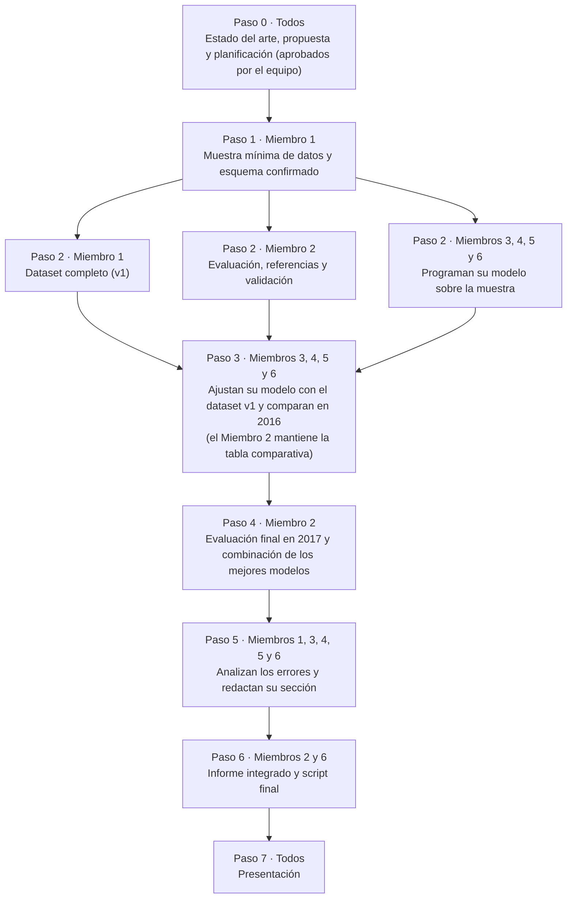

# Planificación del proyecto: pronóstico de generación fotovoltaica con aprendizaje automático

**Proyecto:** photovoltaic-generation-forecasting
**Asignatura:** Machine Learning
**Fase 1:** planificación del trabajo · Noviembre de 2026

> *Nota: documento de trabajo del equipo. Describe la responsabilidad de cada miembro, las actividades que debe realizar, los entregables esperados y la coordinación entre roles. Documentos relacionados: `state_of_the_art.md` (revisión de la literatura) y `proposal.md` (decisiones de diseño).*

---

## 1. Descripción general

El proyecto consiste en construir modelos de aprendizaje automático que, a partir del pronóstico meteorológico del día siguiente, estimen la energía que generará un sistema de paneles solares en cada hora de ese día (24 valores).

La organización del trabajo es la siguiente:

- **Un miembro prepara los datos** para que todo el equipo trabaje con la misma información.
- **Cuatro miembros desarrollan, cada uno, un algoritmo distinto**: red neuronal, SVR, Random Forest y kNN.
- **Un miembro se encarga de la evaluación y la comparación**, de modo que todos los modelos se midan con el mismo criterio y se contrasten con referencias simples.
- Al final se selecciona el mejor modelo, o una combinación de los mejores, y se analizan las razones de los resultados obtenidos.

**Datos utilizados:** la generación medida de viviendas con paneles solares en Utrecht (Países Bajos), registrada cada minuto entre 2014 y 2017, y los datos meteorológicos de la plataforma Open-Meteo.

## 2. Orden de trabajo

El diagrama presenta el orden real en que se desarrolla el proyecto, paso a paso. Los pasos que ocurren al mismo tiempo aparecen en paralelo.



Ningún miembro debe esperar a que el dataset esté completo para comenzar. En el Paso 1 se entrega una versión reducida (algunos meses de datos de un solo sistema), y con ella los miembros 3, 4, 5 y 6 programan sus modelos y el Miembro 2 desarrolla el módulo de evaluación, mientras el Miembro 1 completa el dataset. Cuando el dataset v1 está disponible (Paso 3), solo es necesario sustituir el archivo y realizar el entrenamiento definitivo.

## 3. Reparto de responsabilidades

| Miembro | Rol | Responsabilidad principal |
|---|---|---|
| **Miembro 1** | Dataset | Preparar los datos para todo el equipo |
| **Miembro 2** | Evaluación y comparación | Aplicar el mismo criterio de medición a todos los modelos y compararlos |
| **Miembro 3** | Algoritmo: red neuronal (MLP) | Entrenar y ajustar la red neuronal |
| **Miembro 4** | Algoritmo: SVR | Entrenar y ajustar el modelo SVR |
| **Miembro 5** | Algoritmo: Random Forest | Entrenar y ajustar el modelo Random Forest |
| **Miembro 6** | Algoritmo: kNN y script final | Entrenar y ajustar kNN, y programar el script que pronostica el día siguiente |

## 4. Detalle por miembro

### Miembro 1 · Dataset

**Descripción del rol.** Es el responsable de dejar los datos disponibles para todo el equipo. Dado que el trabajo de los demás miembros depende de este dataset, resulta prioritario entregar pronto una versión reducida y, posteriormente, la versión completa. Todos los procesos se registran en scripts, de modo que cualquier otro miembro pueda repetirlos si fuera necesario.

**Actividades**

1. Descargar el archivo `metadata.csv` de Zenodo (aproximadamente 23 kB), que contiene, para cada uno de los 175 sistemas, su capacidad, inclinación, orientación, ubicación aproximada y periodo de medición.
2. Seleccionar un sistema con una disponibilidad diurna de al menos 95 %, criterio utilizado en uno de los estudios de referencia.
3. Extraer la potencia del sistema seleccionado. Los archivos con control de calidad pesan alrededor de 3 GB cada uno; se descargan una sola vez, se extraen únicamente los datos del sistema elegido (pocos MB) y se comparte ese resultado.
4. Agregar los datos de 1 minuto a **1 hora**.
5. Descargar de Open-Meteo el clima correspondiente a las coordenadas del sistema: radiación de onda corta, nubosidad (total y por capas), temperatura, humedad, viento, presión y precipitación, en hora UTC, igual que la potencia.
6. Unir la potencia y el clima hora por hora. Se debe prestar atención a la alineación temporal: la radiación de Open-Meteo corresponde al promedio de la hora *anterior*, y un desfase de una hora no genera un error visible, pero reduce la calidad del entrenamiento.
7. Limpiar los datos: eliminar valores negativos, interpolar vacíos de hasta 3 horas, descartar los días con más faltantes, excluir la noche y dividir la potencia entre la capacidad AC del sistema.
8. Construir las variables de calendario (hora del día y día del año en forma cíclica, mediante seno y coseno).
9. Entregar por versiones: **muestra mínima** y luego **dataset completo 2014–2017**, con un resumen de los datos descartados.

**Entregables:** `sample.csv`; el dataset v1 con el resumen de huecos y valores descartados, siguiendo el esquema de la sección 5.

**Responsabilidades adicionales:** redactar la sección de datos del informe, analizando la influencia del dataset en los resultados; y, de forma opcional, realizar un experimento con pronósticos reales (un sistema de PVDAQ y el archivo de pronósticos de Open-Meteo) para medir cuánto aumenta el error.

**Coordinación:** con todos los miembros, que utilizan los datos.

**Lectura previa recomendada:** `state_of_the_art.md`, secciones 4.1 a 4.4.

### Miembro 2 · Evaluación y comparación

**Descripción del rol.** Es el responsable de que todos los modelos se evalúen con el mismo criterio, de que la comparación final sea válida y de coordinar la redacción del informe.

**Actividades**

1. Programar el **script de evaluación** que utilizará todo el equipo: MAE, RMSE, nRMSE (normalizado por la capacidad del sistema) y R², calculados únicamente en las horas con luz solar.
2. Programar las **referencias simples**, que todos los modelos deben superar:
   - persistencia del día anterior (se supone que el día siguiente será igual al anterior),
   - persistencia reescalada por la irradiancia del día objetivo,
   - regresión lineal.
3. Preparar la **validación cruzada secuencial**, que respeta el orden temporal, para que los demás miembros ajusten sus modelos dentro del periodo 2014–2015.
4. Elaborar la **tabla comparativa con los resultados de 2016** a medida que se reciban.
5. Realizar la **evaluación final en 2017, una sola vez y sin reajustes**, y calcular el skill score frente a la persistencia.
6. Analizar el error por **tipo de cielo** (despejado, parcial y cubierto, según la nubosidad).
7. Promediar los dos o tres mejores modelos y comparar el resultado con el mejor modelo individual.
8. Integrar el informe final y verificar que las cifras coincidan con los resultados.

**Entregables:** módulo de evaluación, tabla comparativa, evaluación final, análisis por tipo de cielo, resultado de la combinación e informe integrado.

**Coordinación:** con los cuatro miembros de algoritmos, que le entregan sus predicciones, y con el Miembro 1, que le entrega los datos. Actúa también como suplente del dataset, únicamente en caso de emergencia.

**Lectura previa recomendada:** `state_of_the_art.md`, secciones 6.1 a 6.3.

### Procedimiento común para los miembros 3, 4, 5 y 6 (algoritmos)

Los cuatro miembros siguen el mismo procedimiento, cada uno con un algoritmo distinto:

1. **Con la muestra mínima**, programar el modelo con la interfaz común (`train` y `predict`) y comprobar que entrena, predice y guarda resultados.
2. **Con el dataset completo**, ajustar los hiperparámetros mediante validación secuencial dentro de 2014–2015.
3. **Comparar en 2016** y guardar las predicciones en `results/<model>_predictions.csv`, con las columnas `timestamp_utc` y `prediction`.
4. **Una vez realizada la evaluación final de 2017**, analizar en qué horas y condiciones falla el modelo y redactar un texto breve con las conclusiones.

El objetivo no es únicamente que el modelo funcione, sino comprender su comportamiento: qué ajustes lo mejoran, cuándo falla y por qué. Ese análisis alimenta la comparación final.

### Miembro 3 · Red neuronal (MLP)

**Descripción del rol.** Desarrolla el modelo de red neuronal, formado por capas de neuronas artificiales capaces de representar relaciones complejas entre el clima y la generación.

**Parámetros a ajustar:** entre 3 y 11 neuronas en una capa oculta, función de activación tanh o ReLU y, si el tiempo lo permite, dos capas. En la literatura es uno de los modelos más utilizados y suele obtener buenos resultados, aunque es sensible a su configuración.

**Entregables:** `mlp.py` con la interfaz común, su configuración final, las predicciones de 2016 y un texto sobre sus limitaciones.

**Lectura previa recomendada:** `state_of_the_art.md`, secciones 5.1 y 5.5.

### Miembro 4 · SVR

**Descripción del rol.** Desarrolla el modelo SVR, la variante de regresión de las máquinas de vectores de soporte. Ofrece buen desempeño con volúmenes de datos moderados, pero es muy sensible a la elección de sus parámetros, por lo que su ajuste requiere especial atención.

**Parámetros a ajustar:** el parámetro C (de 1 a 1000), el tipo de kernel (RBF, polinomial o lineal) y epsilon. Las variables deben estar escaladas.

**Entregables:** `svr.py` con la interfaz común, su configuración final, las predicciones de 2016 y un texto sobre sus limitaciones.

**Lectura previa recomendada:** `state_of_the_art.md`, secciones 5.1 y 5.5.

### Miembro 5 · Random Forest

**Descripción del rol.** Desarrolla el modelo Random Forest, un conjunto de árboles de decisión cuyas predicciones se combinan. Es un modelo robusto, de ajuste relativamente sencillo y que permite identificar qué variables influyen más, lo cual facilita la interpretación de los resultados.

**Parámetros a ajustar:** profundidad máxima de los árboles, número mínimo de muestras por hoja y número de árboles.

**Entregables:** `random_forest.py` con la interfaz común, su configuración final, las predicciones de 2016, la importancia de las variables y un texto sobre sus limitaciones.

**Lectura previa recomendada:** `state_of_the_art.md`, secciones 5.1 y 5.5.

### Miembro 6 · kNN y script final

**Descripción del rol.** Desarrolla el modelo kNN, que predice a partir de las horas históricas cuyas condiciones meteorológicas son más similares a las del momento que se quiere pronosticar. Es el algoritmo de menor costo de entrenamiento, por lo que este miembro asume además el **script final** que pronostica el día siguiente.

**Parámetros a ajustar:** número de vecinos (de 3 a 11) y distancia, con las variables estandarizadas. En algunos estudios kNN obtuvo el menor desempeño, por lo que el análisis de sus limitaciones aporta valor a la comparación.

**Entregables:** `knn.py` y `forecast.py`: dada una fecha, el script carga el mejor modelo (o la combinación de los mejores) y muestra las 24 predicciones del día siguiente.

**Sobre el script final.** No corresponde al script de evaluación (responsabilidad del Miembro 2) ni al entrenamiento de cada modelo. Es la función de pronóstico del proyecto: recibe una fecha y devuelve la generación esperada para cada hora del día siguiente. La versión mínima es suficiente (imprime las 24 predicciones); si el tiempo lo permite, puede ampliarse con una visualización, por ejemplo un gráfico de las 24 horas.

**Lectura previa recomendada:** `state_of_the_art.md`, secciones 5.1 y 5.5.

## 5. Normas comunes

### Esquema de datos (una fila por hora)

| Columna | Descripción |
|---|---|
| `timestamp_utc` | Inicio de la hora, en UTC |
| `power_norm` | Potencia horaria dividida entre la capacidad AC del sistema (variable que se predice) |
| `ghi` | Radiación de onda corta (media de la hora precedente) |
| `cloud_total`, `cloud_low`, `cloud_mid`, `cloud_high` | Cobertura de nubes |
| `temperature`, `humidity`, `wind`, `pressure`, `precipitation` | Variables meteorológicas secundarias |
| `hour_sin`, `hour_cos`, `doy_sin`, `doy_cos` | Hora del día y día del año en forma cíclica |
| `is_day` | Indicador de las horas con radiación (la noche se excluye) |

El esquema es **provisional** hasta que el Miembro 1 entrega la muestra mínima: en ese momento confirma o ajusta las columnas con base en los datos reales y el esquema se **congela**. Cualquier modificación posterior debe comunicarse y acordarse previamente entre todos.

### Partición temporal

| Uso | Periodo | Regla |
|---|---|---|
| Entrenamiento y ajuste | 2014–2015 | Los hiperparámetros se ajustan en este periodo con validación secuencial |
| Comparación entre modelos | 2016 | Se utiliza para elegir y comparar |
| Evaluación final | 2017 | **No se utiliza hasta el final** y se evalúa una sola vez |

### Interfaz de los modelos

Cada algoritmo se implementa en `src/models/<name>.py` como una clase que hereda de la interfaz común `ModelInterface` (`src/models/base.py`) y define dos métodos:

- `train(X, y)`: ajusta el modelo con las horas de luz del periodo de entrenamiento.
- `predict(X)`: devuelve la potencia normalizada para cada hora, con el mismo índice que `X`.

`X` contiene todas las columnas de entrada y cada modelo elige las que usa (véase *Variables de entrada*). Las predicciones se ajustan después de forma común para todos los modelos: la noche se pone en cero y el resto se recorta al rango [0, 1]. Las funciones auxiliares (separar `X` e `y`, ajustar y guardar predicciones, guardar y cargar modelos) están en `src/models/utils.py`, y `src/models/README.md` explica cómo crear un modelo a partir de la plantilla `example.py`.

De este modo, el Miembro 2 puede comparar y combinar los modelos sin modificar el código.

### Variables de entrada

- **Obligatorias para todos los modelos:** radiación (`ghi`), nubosidad, temperatura y las variables de calendario.
- **Opcionales:** humedad, viento, presión y precipitación. Cada miembro prueba si mejoran su modelo, eligiendo solo con la validación de 2014–2015, y documenta en su texto final qué columnas usó y por qué.

Los nombres de las columnas y estos grupos están definidos en `src/schema.py`.

### Reglas de trabajo

- **El año 2017 no se utiliza** para ajustar parámetros ni para elegir modelos.
- **Los mismos datos y la misma partición** para todos los modelos; solo así la comparación es válida.
- **Escalas y promedios calculados únicamente con datos de entrenamiento**, nunca con datos de validación o prueba.
- **Semillas fijas y predicciones guardadas** en `results/`, para que los resultados sean reproducibles.
- **Cada decisión de preprocesamiento queda documentada.**
- **Cualquier retraso se comunica con anticipación** (véase la sección 7).

## 6. Fases

| Fase | Descripción | Hito |
|---|---|---|
| **0. Estado del arte, propuesta y planificación** | Se revisó la literatura, se definieron las decisiones de diseño (propuesta) y se planificó el trabajo. El equipo aprueba la partición, las métricas y un esquema de datos provisional. | Documentos aprobados por el equipo |
| **1. Muestra mínima** | Se entrega una versión reducida de los datos y se confirma el esquema. Con ella se verifica que todo el flujo funciona (datos, entrenamiento, predicción y métricas) y cada miembro programa su modelo. | Todo el flujo funciona sobre la muestra |
| **2. Dataset completo** | Se construye, corrige y publica el dataset completo 2014–2017 y se congela el esquema. | Dataset v1 publicado |
| **3. Entrenamiento y ajuste** | Con el flujo ya probado sobre la muestra, cada miembro entrena y ajusta su modelo con el dataset completo y se compara en 2016. | Cada modelo con su configuración final |
| **4. Evaluación final** | Se evalúa en 2017, se combinan los mejores modelos y se analizan los errores. | Tabla final de resultados |
| **5. Entrega** | Se integran el informe, la presentación y el script final. | Todo listo para la entrega |

### Actividades por fase

| Fase | Miembro 1 | Miembro 2 | Miembros 3, 4, 5 y 6 |
|---|---|---|---|
| **0** | Revisar y aprobar los documentos | Revisar y aprobar los documentos | Revisar y aprobar los documentos |
| **1** | Muestra mínima de datos | Evaluación y referencias | Programar su modelo sobre la muestra |
| **2** | Dataset completo | Validación secuencial y análisis por tipo de cielo | Continuar el desarrollo de su modelo |
| **3** | Revisar el dataset; opcional: preparar el experimento con pronósticos reales | Tabla comparativa de 2016 | Ajustar hiperparámetros y comparar en 2016 |
| **4** | Sección de datos; opcional: experimento con pronósticos reales | Evaluación 2017 y combinación de los mejores modelos | Analizar las limitaciones de su modelo y redactar el texto |
| **5** | Presentación | Integrar el informe | Presentación; el Miembro 6 deja listo el script final |

## 7. Contingencias

Dado que la disponibilidad de tiempo y de conexión puede variar entre los miembros, el plan se diseñó para que un retraso individual no detenga al resto del equipo:

- **Muestra mínima primero.** Permite que los cuatro miembros de algoritmos avancen aunque el dataset completo demore.
- **Entrega por versiones.** Muestra, algunos años y dataset completo. Los modelos pueden comenzar a entrenarse con la versión intermedia.
- **Procesos en scripts**, no manuales. Si un miembro se retrasa, otro puede repetir los pasos ya escritos.
- **Descargas pesadas una sola vez.** El archivo de Utrecht pesa alrededor de 3 GB: se descarga una sola vez y se comparte únicamente el sistema extraído (pocos MB). El resto del equipo no necesita el archivo grande.
- **Suplente del dataset:** el Miembro 2, quien tiene poca carga al inicio, únicamente en caso de emergencia.
- **Recorte de alcance.** Si es necesario reducir el trabajo, lo primero que se omite es el experimento opcional con pronósticos reales.
- **Comunicación anticipada.** Avisar de un retraso con tiempo permite reajustar tareas sin afectar al resto.

## 8. Estructura de carpetas

```
photovoltaic-generation-forecasting/
├── README.md
├── docs/
│   ├── state_of_the_art.md
│   ├── proposal.md
│   └── planning.md
├── data/                  # datos descargados (no se suben archivos pesados)
├── notebooks/             # exploración y análisis
├── src/
│   ├── data/              # descarga y limpieza (Miembro 1)
│   ├── models/            # knn.py, mlp.py, svr.py, random_forest.py
│   ├── evaluation/        # referencias, métricas y validación (Miembro 2)
│   └── forecast.py        # script final (Miembro 6)
└── results/               # predicciones y tablas
```

## 9. Resumen de entregables

| Entregable | Responsable |
|---|---|
| Dataset y scripts de datos | Miembro 1 |
| Módulo de evaluación, referencias y tabla comparativa | Miembro 2 |
| Modelo MLP | Miembro 3 |
| Modelo SVR | Miembro 4 |
| Modelo Random Forest | Miembro 5 |
| Modelo kNN y script de pronóstico | Miembro 6 |
| Combinación final de los mejores modelos | Miembro 2 |
| Informe final | Miembro 2 (coordina) y todos |
| Presentación | Todos |
